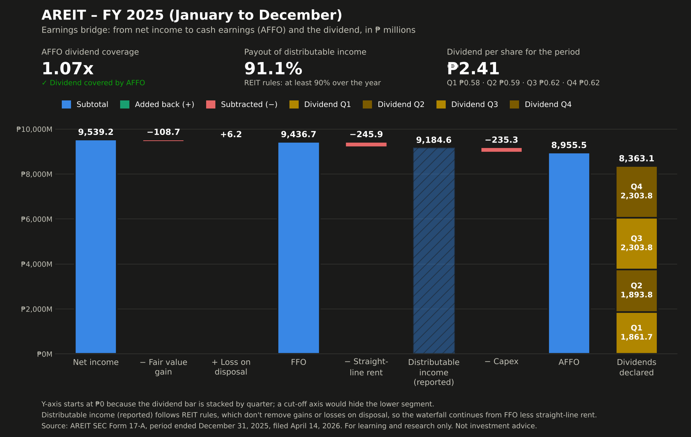

# AREIT — FY 2025 (January to December) review

**In one sentence:** In 2025, AREIT earned ₱1.07 in cash earnings for every ₱1 it declared in dividends for the year, so the dividend was backed by real cash, based on audited figures.

**Dividend safety:** green — The dividend is covered by cash earnings.

This review uses AREIT's annual report (SEC Form 17-A), whose financial statements are audited. Page numbers are positions in the 699-page PDF, because the printed numbering restarts in each part.

## Worth knowing
- **Part of the revenue is owed by the sponsor group.** About 1 or 2 of every 10 pesos of revenue (16.5%) is interest on malls and hotels leased to companies related to the sponsor, Ayala Land (finance leases), and is often collected later. The amount owed under these leases grew ₱15,413.3M during the year as more malls were added under such leases.
- **Cash was lent to the sponsor group.** During the year the REIT lent ₱1,269.2M to companies in its sponsor's group, equal to 13% of net income.
- **New shares were issued.** The REIT issued 505.9M new shares (15.8% more) in September 2025, to Ayala Land and its subsidiaries in exchange for properties. The Q3 and Q4 dividends were shared across these extra shares.
- **More shares were pending at year-end.** Stockholders approved, on December 11, 2025, issuing 441,131,656 new shares for Ayala Center Cebu and Ayala Malls Feliz with a transaction value of ₱19.48 billion, still awaiting SEC approval at year-end (p.64). That works out to ₱44.16 per share (our calculation from the two disclosed figures; the filing states no price), 20.7% above the ₱36.57 book value per share.

## From earnings to dividend

| Step | ₱ millions | Source (page · search phrase · column) |
|---|---|---|
| Net income | 9,539.2 | p.56 · "Net income for the year" · 2025 |
| ± Fair value change (paper gain/loss) | −108.7 | p.56 · "Net fair value change in investment" · 2025 |
| + Loss on disposal of property (not an operating result) | +6.2 | p.58 · "Loss on disposal of investment properties" · 2025 |
| = FFO (funds from operations) | 9,436.7 | computed |
| − Straight-line rent (booked, not yet collected) | −245.9 | p.85 · "Straight-lining adjustments recorded in rental" · 2025 |
| Distributable income (reported; shown for comparison) | 9,184.6 | p.85 · "Distributable income" · 2025 |
| − Capex (spending on the buildings) | −235.3 | p.58 · "Investment properties" · 2025 |
| = AFFO (cash earnings after upkeep) | 8,955.5 | computed |
| Dividends declared for 2025: | | |
| &nbsp;&nbsp;Q1: ₱0.58 × 3,209,865,985 shares | 1,861.7 | p.69 · "Q1 of 2025"; shares: p.67 · "Outstanding shares at December 31" · 2024 |
| &nbsp;&nbsp;Q2: ₱0.59 × 3,209,865,985 shares | 1,893.8 | p.69 · "Q2 of 2025"; shares: p.67 · "Outstanding shares at December 31" · 2024 |
| &nbsp;&nbsp;Q3: ₱0.62 × 3,715,756,162 shares | 2,303.8 | p.69 · "Q3 of 2025"; shares: p.67 · "Outstanding shares at December 31" · 2025 |
| &nbsp;&nbsp;Q4: ₱0.62 × 3,715,756,162 shares | 2,303.8 | p.87 · "fourth quarter of 2025"; shares: p.67 · "Outstanding shares at December 31" · 2025 |
| = Total dividends for the year | 8,363.1 | computed |
| Coverage (AFFO ÷ dividends) | 1.07x | computed |

The fair value change was a gain this year: the year-end appraisal added ₱432.8M, from which the company nets the straight-line offset (₱245.9M) and lease commissions (₱78.3M) (p.63). Distributable income follows REIT rules, which don't remove the loss on disposal, so it sits just off the path from FFO to AFFO. The Q4 dividend was declared in February 2026 but counts toward 2025; Q1 and Q2 were paid on the share count before the September 2025 swap.

## Three-year trend
| Year | Coverage (AFFO ÷ dividends) | Payout of distributable income | Book NAV per share | Dividends declared (₱M) | Distributable income (₱M) |
|---|---|---|---|---|---|
| 2023 | 1.04 | 91.9% | ₱35.21 | 4,454.6 | 4,844.7 |
| 2024 | 1.06 | 92.6% | ₱35.32 | 6,376.3 | 6,887.3 |
| 2025 | 1.07 | 91.1% | ₱36.57 | 8,363.1 | 9,184.6 |

2024's capex excludes the ₱1,192.0M cash purchase of the SEDA Lio hotel building (p.63), since buying a building isn't upkeep. 2023 uses the audited distributable income (p.85); the dividends section prints a different figure for that year (see Checks).

## Checks
- Balance sheet balances: passed
- Net income before fair value change matches management's discussion: passed
- Distributable income (the amount REIT rules use for payouts) reconciles: passed
- Each dividend's per-share amount × shares, and the year's total, match the reported amounts: passed
- Fair value change parts (appraisal gain, straight-line offset, lease commissions) add up: passed
- Interest coverage matches the company's own figure: passed
- Payout meets the REIT rule's 90% minimum: passed (91.05%)
- Payout matches the company's own figure: passed
- Q4 dividend declared after year-end is within retained earnings available for dividends (₱2,303.8M vs ₱8,203.1M): passed
- Figures printed in more than one place: needs review. The 2023 distributable income is ₱4,844.7M in the audited note (p.85) but ₱4,931.3M in the dividends section (p.14), a difference of ₱86.6M, exactly that year's straight-line adjustment. This is likely an inconsistency in the filing, not in our numbers.
- Earlier years' stated payouts: needs review. The dividends section's 90.33% for 2023 rests on that higher figure; on the audited figure it is 91.95%.

## Other figures
- Dividend per share declared for 2025: ₱2.41 (₱0.58, ₱0.59, ₱0.62 and ₱0.62)
- Payout of distributable income: 91.05%, above the REIT rule's 90% minimum for the year, and the same as the company's own figure (p.13)
- NAV per share (book): ₱36.57 (total equity ÷ shares; the 17-A reports no NAV per share)
- NAV per share with finance lease receivables at fair value: ₱38.17. The finance lease receivables are carried at ₱35,086.5M but the company discloses a fair value of ₱41,001.4M (p.85), a ₱5,914.9M difference
- Price ÷ NAV: 1.19x — ₱43.50 close for the fourth quarter of 2025 (p.12 · "Fourth Quarter" · Close) ÷ book NAV ₱36.57
- Dividend yield: 5.70% on the latest quarter × 4 (₱0.62 × 4 = ₱2.48); 5.54% on the year's dividends (₱2.41)
- Interest coverage: 34.73x (EBITDA ₱9,529.3M ÷ interest expense ₱274.4M); debt is low
- Assets not at fair value: 23.8% (finance lease receivables ÷ total assets)
- Appraisal: an independent appraiser valued the properties at year-end using the income approach, with discount rates of 8.28% to 9.42% (p.63, p.80)
- Sponsor ownership: 58.45%

---
Source: SEC Form 17-A, fiscal year ended December 31, 2025, filed April 14, 2026 (audited financial statements). For learning and research only. Not investment advice.
