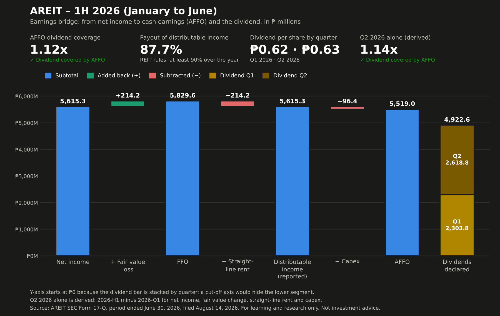

# AREIT — 1H 2026 (January to June) review

**In one sentence:** In the first half of 2026, AREIT earned ₱1.12 in cash earnings for every ₱1 it declared in dividends for those two quarters, so the dividend is backed by real cash.

**Dividend safety:** green — The dividend is covered by cash earnings.

**Q2 2026 alone (derived):** 1.14x — in April to June by itself, AREIT earned ₱2,998.3M in cash earnings against a ₱2,618.8M Q2 dividend. Worked out by subtracting the Q1 2026 report's figures from the six-month figures, so treat it as a check on the trend, not a reported figure. The derived Q2 net income matches the filing's own April-to-June column.

This review covers six months because the quarterly report (SEC Form 17-Q) only shows cash flows for the year to date.

## Worth knowing
- **Part of the revenue is owed by the sponsor group.** About 2 of every 10 pesos of revenue (24.3%) is interest on malls and hotels leased to companies related to the sponsor, Ayala Land (finance leases), and is often collected later; the filing lists it as a non-cash item. The amount owed under these leases grew ₱20,328.2M, mostly because two malls worth ₱19,476.0M were added under such leases in June.
- **Cash was lent to the sponsor group.** During the six months the REIT lent ₱686.0M to companies in its sponsor's group, equal to 12% of net income.
- **New shares were issued.** The REIT issued 441.1M new shares (11.9% more) on June 25, to Ayala Land and a subsidiary in exchange for Ayala Center Cebu Mall and Ayala Malls Feliz. The Q2 dividend is shared across these extra shares, while the two malls contributed only a few days of income to this period, so the next quarter is a better test of coverage.

## From earnings to dividend

| Step | ₱ millions | Source (page · search phrase · column) |
|---|---|---|
| Net income | 5,615.3 | p.7 · "NET INCOME" · January 1 to June 30, 2026 |
| ± Fair value change (paper gain/loss) | +214.2 | p.7 · "Net fair value change in investment properties" · January 1 to June 30, 2026 |
| = FFO (funds from operations) | 5,829.6 | computed |
| − Straight-line rent (booked, not yet collected) | −214.2 | p.18 · "Straight-line adjustments recorded in rental income" · June 30, 2026 |
| = Distributable income (reported) | 5,615.3 | p.18 · "Distributable income" · June 30, 2026 |
| − Capex (spending on the buildings) | −96.4 | p.9 · "Payments for additions to investment properties" · January 1 to June 30, 2026 |
| = AFFO (cash earnings after upkeep) | 5,519.0 | computed |
| Dividends declared: | | |
| &nbsp;&nbsp;Q1: ₱0.62 × 3,715,756,162 shares | 2,303.8 | p.18 · "for the first quarter of 2026"; shares: p.17 · "Outstanding shares" · December 31, 2025 |
| &nbsp;&nbsp;Q2: ₱0.63 × 4,156,887,818 shares | 2,618.8 | p.21 · "for the second quarter of 2026"; shares: p.4 · "Common shares" |
| = Total dividends for the period | 4,922.6 | computed |
| Coverage (AFFO ÷ dividends) | 1.12x | computed |

Each dividend uses the share count on its own record date: Q1's (May 28) was before the 441.1M new shares were issued on June 25, Q2's (August 25) was after. The company's own totals, ₱2,303.77 million (p.18) and ₱2,618.84 million (p.29), confirm both.

## Checks
- Balance sheet balances: passed
- FFO matches the figure in management's discussion: passed
- Distributable income (the amount REIT rules use for payouts) reconciles: passed
- Each dividend's per-share amount × shares matches its reported total: passed
- NAV per share matches the company's own figure: passed
- Derived Q2 net income and fair value change match the filing's April-to-June column: passed

## Other figures
- Dividend per share declared: ₱0.62 for Q1 and ₱0.63 for Q2 (₱1.25 for the half)
- Payout of distributable income: 87.7% for the half. REIT rules require at least 90% over a full year, so this is worth watching at year end rather than a problem now.
- NAV per share (estimate): ₱37.60 — book equity per share; finance lease receivables are at cost, not market value
- Sponsor ownership: 58.94%

---
Source: SEC Form 17-Q, quarter ended June 30, 2026, filed August 14, 2026. For learning and research only. Not investment advice.
