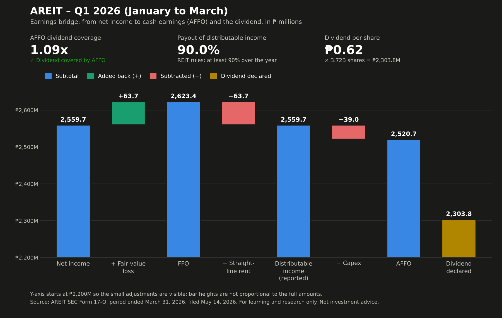

# AREIT — Q1 2026 review

**In one sentence:** AREIT earned ₱1.09 in cash earnings for every ₱1 it declared in dividends this quarter, so the dividend is backed by real cash.

**Dividend safety:** green — The dividend is covered by cash earnings.

## Worth knowing
- **One adjustment needs a second look.** The report's adjustment for rent not yet collected (₱63.7M) equals the fair value change to the peso, and doesn't match the ₱41.1M rise in uncollected rent on the balance sheet. This may be an accounting convention, but it's worth checking in the annual report.
- **Part of the revenue is owed by the sponsor group.** About 2 of every 10 pesos of revenue (19.3%) is interest on buildings leased to companies related to the sponsor (finance leases), and is often collected later. That receivable grew ₱427.9M this quarter.
- **Cash was lent to the sponsor group.** During the quarter the REIT lent ₱794.9M to companies in its sponsor's group, equal to 31% of net income.

## From earnings to dividend

| Step | ₱ millions | Source (page · search phrase) |
|---|---|---|
| Net income | 2,559.7 | p.5 · "NET INCOME" |
| ± Fair value change (paper gain/loss) | +63.7 | p.5 · "Net fair value change in investment properties" |
| = FFO (funds from operations) | 2,623.4 | computed |
| − Straight-line rent (booked, not yet collected) | −63.7 | p.18 · "Straight-line adjustments recorded in rental income" |
| = Distributable income (reported) | 2,559.7 | p.18 · "Distributable income" |
| − Capex (spending on the buildings) | −39.0 | p.7 · "Payments for additions to investment properties" |
| = AFFO (cash earnings after upkeep) | 2,520.7 | computed |
| Dividend declared for the quarter (₱0.62 × 3,715,756,162 shares) | 2,303.8 | p.21 · "Cash dividend for Q1 2026 (declared May 13, 2026)" |
| Coverage (AFFO ÷ dividend) | 1.09x | computed |

## Checks
- Balance sheet balances: passed
- FFO matches the figure in management's discussion: passed
- Distributable income (the amount REIT rules use for payouts) reconciles: passed
- Dividend per share × shares matches the reported total: passed

## Other figures
- Payout of distributable income: 90.0%
- NAV per share (estimate): ₱36.64 — book equity per share; finance lease receivables are at cost, not market value
- Dividend per share declared: ₱0.62
- Sponsor ownership: 56.08%

---
Source: SEC Form 17-Q, quarter ended March 31, 2026, filed May 14, 2026. For learning and research only. Not investment advice.
